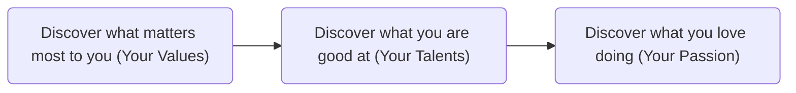

<div align="center">

### ✨ Find What You Want To Do

### ⭐️ Support This Project

如果这个项目帮助你建立了更好的自我认知，欢迎点一个 ⭐️ Star 支持！

你的每一次 Star，都是持续更新的动力 ❤️

<div align="center">
  <a href="#zh"></a>
  <a href="#en"></a>
</div>

</div>

---

<a id="zh"></a>

## 找到想做的事

一个AI Skill：用「自我认知法」通过若干个结构化问题，帮你找到**真正想做的事**。

> 方法论来源：
> 八木仁平《如何找到想做的事》（原名『世界一やさしい「やりたいこと」の見つけ方』）中的「自我认知法」。本仓库是该方法在 AI 对话场景下的实现，不是原著，也不替代原著——书里关于「为什么找不到想做的事」的部分值得一读。

## 破除一些固有观念

1. 想要做的事并非是能坚持一生的事，它应该是现在最想要做的事。
2. 想要做的事并不是命中注定的，它是在探索中发现的。
3. 想要做的事并不是有利于他人的事，有利于自己也是一件快乐的事。
4. 在探索过程中，并非只需要行动就可以找到想要做的事，有时恰恰是因为选项过多导致找不到想做的事，内心标准才是答案。
5. 想做的事一定是有对应工作的，想做的事情是什么在内心中，想做的事的实现手段是在外部社会。

## 核心公式

> 喜欢的事（热情） × 擅长的事(才能) × 重要的事(价值观) = 真正想做的事

理解自我，你只需要做三件事：


## 如何使用

### Claude Code 安装

```bash
git clone https://github.com/lconfz/find-your-thing.git

# 复制到 Claude Code skills 目录
mkdir -p ~/.claude/skills
cp -r find-your-thing ~/.claude/skills/
```

### Codex 安装

```bash
git clone https://github.com/lconfz/find-your-thing.git

# 复制到 Codex skills 目录
mkdir -p ~/.agents/skills
cp -r find-your-thing ~/.agents/skills/
```

### 开始使用

装好后直接说说你现在的状态就行——问题匹配到技能的 `description` 时会自动加载；在 Claude Code 中也可以用斜杠命令显式调用：

```text
@find-your-thing 我想找到自己真正想做的事是什么？
```

整个过程一次只问一个问题，可以分几次做完，也可以随时中断。


## 许可证

本项目基于 MIT 许可证开源 - 详情请参阅 [LICENSE](LICENSE) 文件。

<a id="en"></a>

## Find What You Want To Do

An AI Skill: Using a self-discovery framework with structured questions to help you uncover **what you truly want to do**.

> Methodology Source:
> 
> The "Self-Discovery Method" from Jinpei Yagi's How to Find What You Want to Do (Original Japanese title: The World's Easiest Way to Find What You Want to Do).
> 
> This repository is an implementation of this method tailored for AI conversational scenarios. It is not the original work, nor is it intended to replace it—the sections in the book exploring "why we struggle to find what we want to do" are highly recommended reading.

## Debunking Some Common Myths

1. What you want to do doesn't have to be a lifelong commitment; it should simply be what you most want to do right now.

2. What you want to do isn't predestined; it is discovered through exploration.

3. What you want to do doesn't have to be about benefiting others. Doing something that benefits you is a source of joy in itself.

4. In the process of exploration, taking action alone isn't enough to find what you want to do. Sometimes, it's precisely an abundance of options that makes it hard to choose. Your internal criteria are the real answer.

5. There is always a corresponding job for what you want to do. What you want to do lies within your heart, while how to achieve it is found in the external world.

## The Core Formula

What you love (Passion) × What you are good at (Talents) × What matters most (Values) = What you truly want to do

To understand yourself, you only need to do three things:



## How to Use

### Install for Claude Code

```bash
git clone https://github.com/lconfz/find-your-thing.git

# Copy into the Claude Code skills directory
mkdir -p ~/.claude/skills
cp -r find-your-thing ~/.claude/skills/
```

### Install for Codex

```bash
git clone https://github.com/lconfz/find-your-thing.git

# Copy into the Codex skills directory
mkdir -p ~/.agents/skills
cp -r find-your-thing ~/.agents/skills/
```

### Get Started

After installing, just describe where you are—the skill loads automatically when your request matches its `description`, or, in Claude Code, invoke it explicitly with a slash command:

```text
@find-your-thing I want to figure out what I truly want to do.
```

It asks one question at a time, can be spread across several sessions, and you can stop at any point.

## License

This project is licensed under the MIT License - see the [LICENSE](LICENSE) file for details.

<!-- 底部也可以加一个返回顶部的链接 -->
<div align="center">
  <a href="#">⬆️ Back to Top</a>
</div>